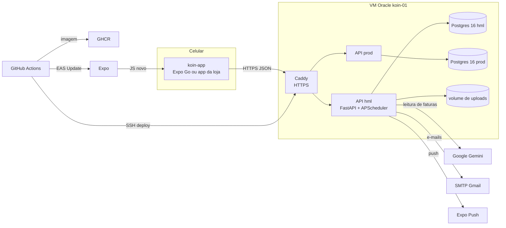

# Entrega do projeto Koin

*Data:* 12/11/2026
*Responsáveis pela entrega:* Julio Dourado e Brenno da Silva Oliveira (grupo de infra)
*Para:* cliente do Koin

Este documento entrega o código, as contas e o conhecimento para continuar o Koin: como está organizado, como roda, como é testado, o que custa e quais chaves são necessárias. Os custos estão em [custos.md](custos.md).

## Sumário

1. [O que é o Koin hoje](#1-o-que-é-o-koin-hoje)
2. [O que é entregue (checklist de chaves)](#2-o-que-é-entregue-checklist-de-chaves)
3. [Organização no GitHub](#3-organização-no-github)
4. [Arquitetura](#4-arquitetura)
5. [Tecnologias](#5-tecnologias)
6. [Pipeline (GitHub Actions)](#6-pipeline-github-actions)
7. [Hospedagem e ambientes](#7-hospedagem-e-ambientes)
8. [Testes e cobertura](#8-testes-e-cobertura)
9. [Rodar localmente](#9-rodar-localmente)
10. [Chaves e variáveis](#10-chaves-e-variáveis)
11. [O que falta para a produção](#11-o-que-falta-para-a-produção)
12. [Onde está cada documento](#12-onde-está-cada-documento)

---

## 1. O que é o Koin hoje

App de finanças para casais e famílias que gastam principalmente no cartão. A pessoa envia a fatura (PDF ou foto), a IA lê as compras, o app monta o cartão e as faturas, e a família vê quem gastou o quê e quem deve a quem.

Fluxos prontos e validados na homologação:

| Fluxo | Documento |
|---|---|
| Cadastro por convite, login, sessão persistente, recuperação de senha, exclusão e exportação de dados (LGPD) | [Sprint 3](../sprint3/entrega-sprint3.md) |
| O cartão nasce da fatura: enviar a fatura, reconhecer ou cadastrar o cartão, revisar e confirmar | [fluxo-cartao-pela-fatura.md](../produto/fluxo-cartao-pela-fatura.md) |
| Comprovantes: pagamento de fatura e compra pelo final do cartão | [fluxo-cartao-pela-fatura.md, seção 8](../produto/fluxo-cartao-pela-fatura.md) |
| Parcelamentos, pagamento de fatura, resumo do mês, notificações | koin-app (telas) |
| Família: convite, divisão do mês, acerto, partes proporcionais, cartão da casa | [familia-divisao.md](../produto/familia-divisao.md) |

O app **não foi publicado nas lojas**. Ele roda no Expo Go, pelo canal de homologação (seção 7).

## 2. O que é entregue (checklist de chaves)

| # | Item | Situação hoje | O que fazer na entrega |
|---|---|---|---|
| 1 | **Organização no GitHub** [`AppFinanceiro-GECS`](https://github.com/AppFinanceiro-GECS) (repositórios `koin-api`, `koin-app`, `koin-docs` e o legado `biveto-fin`) | 11 membros, todos **owners** | Adicionar o cliente como owner. Depois, rebaixar ou remover os alunos que saem do projeto |
| 2 | **Conta Google do produto** `superappkoin@gmail.com` | Dona dos projetos Google Cloud `koin-hml` e `koin-prod` (Gemini) e remetente dos e-mails da homologação | Entregar a senha e trocar a verificação em duas etapas e o e-mail de recuperação para o cliente |
| 3 | **Conta Expo** `superappkoin2` (dona da org Expo `superappkoin`, projeto `@superappkoin/koin`) | Login com o e-mail do item 2. A conta pessoal `typejulio` é admin | Entregar a senha, remover a `typejulio` e gerar um novo `EXPO_TOKEN` (seção 10) |
| 4 | **Servidor** (Oracle Cloud, VM `koin-01`) | Na **conta Oracle pessoal do Julio**, no plano gratuito | Fica no ar até **31/12/2026**. Em 2027 a VM será desligada. O cliente precisa de um servidor próprio antes disso (seção 7.3) |
| 5 | **Chave do Gemini da homologação** | Projeto do AI Studio da conta pessoal do Julio, plano gratuito | Some junto com o item 4. Criar a chave paga no projeto `koin-prod` da conta do item 2 |
| 6 | **Documentação** | Este repositório (`koin-docs`) e os `docs/` de cada repositório | Nada: já está no GitHub |

Ninguém do time guarda cópia das senhas depois da entrega. Os segredos do servidor existem só no `.env` da VM e não estão em nenhum repositório.

## 3. Organização no GitHub

| Repositório | Conteúdo | Branches |
|---|---|---|
| [`koin-api`](https://github.com/AppFinanceiro-GECS/koin-api) | Backend (FastAPI), banco, IA, infra e deploy | `main` (homologação) e `prod` (produção) |
| [`koin-app`](https://github.com/AppFinanceiro-GECS/koin-app) | App mobile (React Native + Expo) | `main` (canal `preview`) e `prod` (canal `production`) |
| [`koin-docs`](https://github.com/AppFinanceiro-GECS/koin-docs) | Entregas das sprints, produto e esta entrega | `main` |
| `biveto-fin` | Monorepo antigo, antes da divisão em set/2026 | Só referência |

- **Como se trabalha:** issue → branch (`feat/`, `fix/`, `docs/`, `chore/`) → PR para a `main` com o CI verde → merge. Para ir à produção, PR da `main` para a `prod`. Regras em [`koin-api/CONTRIBUTING.md`](https://github.com/AppFinanceiro-GECS/koin-api/blob/main/CONTRIBUTING.md).
- **Backlog:** project *Quadro Kanban* da organização, com épicos e issues priorizadas pelas labels `P0` a `P2`.
- **Os repositórios são públicos.** Por isso só há dados fictícios nos testes e nos documentos.

## 4. Arquitetura

**koin-api** (`app/`):
- `core/`: configuração, banco, segurança (JWT com refresh, rate limit), agendador, logs JSON
- `models/`: modelos SQLAlchemy; 50 migrações Alembic
- `modules/`: um diretório por domínio, cada um com `routers/`, `schemas/` e `services/`. São 29 domínios e 266 rotas (auth, accounts, transactions, documents, credit_cards, household, installments e outros)
- `modules/documents`: o pipeline de leitura (upload validado pelo conteúdo → OCR e IA → validação → revisão no app). Etapas visíveis ao app: `received`, `extracting`, `validating`, `done`
- Módulos ativos por ambiente com `ENABLED_MODULES` (`all` na hml, `mvp` na produção)

**koin-app** (`src/`):
- `app/`: rotas do Expo Router (arquivos = telas). `(auth)` é login e convite; `(app)/(tabs)` são Início, Transações, Contas e Perfil
- `services/`: um cliente por domínio da API (axios, com refresh automático do token)
- `stores/`: Zustand (sessão, com os tokens no Keychain/Keystore)
- `types/`: `schemas.ts` (gerado do OpenAPI) e `api.ts` (legado, escrito à mão)
- `components/`: componentes base e por fluxo (família, faturas, parcelas)

Decisões de arquitetura e motivos: [`koin-api/docs/onboarding/03-DECISOES-E-MOTIVOS.md`](https://github.com/AppFinanceiro-GECS/koin-api/blob/main/docs/onboarding/03-DECISOES-E-MOTIVOS.md).

## 5. Tecnologias

| Camada | Tecnologias |
|---|---|
| API | Python 3.12, FastAPI, SQLAlchemy 2 (async), Alembic, Pydantic 2, APScheduler, slowapi (rate limit), uv (lock com hash) |
| Banco | PostgreSQL 16 (produção e hml); SQLite nos testes e no modo sem Docker |
| IA | Google Gemini (`gemini-3.5-flash-lite` na hml), com DeepSeek e Mistral como alternativas configuráveis; OCR local com Tesseract e zbar |
| App | Expo SDK 58, React Native 0.88, React 19, Expo Router, TanStack Query, Zustand, axios, zod, TypeScript |
| Infra | Docker e Docker Compose, Caddy (HTTPS automático), GHCR (imagens `amd64` e `arm64`), Oracle Cloud ARM |
| Qualidade | ruff, pytest e pytest-cov, pip-audit, gitleaks, Trivy, ESLint (eslint-config-expo), `tsc`, expo-doctor, openapi-typescript, Dependabot |

## 6. Pipeline (GitHub Actions)

### koin-api (`.github/workflows/ci.yml`)

Roda em todo PR e em todo push na `main` e na `prod`.

| Job | O que garante |
|---|---|
| Secret Scan (gitleaks) | Nenhuma chave commitada |
| Lint + Testes | `ruff check`, `ruff format --check`, lock em dia, pytest com cobertura mínima de **55%**; exporta o `openapi.json` |
| Testes (Postgres) | A mesma suíte contra um Postgres 16 real |
| Migrações | `alembic upgrade` no SQLite e `upgrade → downgrade -1 → upgrade` no Postgres |
| pip-audit | Nenhuma dependência com vulnerabilidade conhecida |
| Docker build + smoke test | A imagem sobe e responde ao `/health`; scan da imagem com Trivy |
| Build image / Publish (GHCR) | Só em push: imagem `amd64` + `arm64` em `ghcr.io/appfinanceiro-gecs/koin-api` |
| Deploy | Só em push: `main` → homologação, `prod` → produção, por SSH, com volta automática para a imagem anterior se a API não ficar saudável |
| Smoke E2E (homologação) | Fluxo principal contra a hml depois do deploy: login, cartão, compra no cartão e listagem (`scripts/smoke_e2e.py`) |
| Release | Só na `prod`: tag `vX.Y.Z` com o `openapi.json` anexado |

Também há o `dependabot-automerge.yml`, que faz merge sozinho das atualizações de patch do Dependabot quando o CI passa.

### koin-app (`.github/workflows/ci.yml`)

| Job | O que garante |
|---|---|
| Secret Scan (gitleaks) | Nenhuma chave commitada |
| Lint + Typecheck + Bundle | ESLint, `tsc --noEmit`, expo-doctor e o bundle de Android e iOS |
| Tipos da API (OpenAPI) | Avisa (sem bloquear) quando os tipos gerados estão atrás da API |
| EAS Update | PR → canal `pr-N`, com QR code comentado no PR; `main` → `preview`; `prod` → `production` |

Um merge na `main` do koin-app chega ao celular dos testadores sem build novo: o Expo Go baixa o JavaScript novo ao abrir.

## 7. Hospedagem e ambientes

### 7.1 Onde está cada coisa

| O quê | Onde | Conta |
|---|---|---|
| API e banco de homologação | https://hml.144-22-232-63.sslip.io (Swagger em `/docs`) | Oracle do Julio |
| API de produção | `https://api.144-22-232-63.sslip.io`, **ainda não subiu** (`/opt/koin/prod` vazio) | Oracle do Julio |
| Página que abre o app de homologação | https://app.144-22-232-63.sslip.io | Oracle do Julio |
| App de homologação | Expo Go, canal `preview`: `exp://u.expo.dev/9d8026b4-723d-4f73-87f2-16c484f8585e?channel-name=preview` | Expo `superappkoin` |
| Imagens da API | `ghcr.io/appfinanceiro-gecs/koin-api` | GitHub da org |
| IA | Google AI Studio / Google Cloud | Item 5 da seção 2 |
| E-mail | Gmail SMTP de `superappkoin@gmail.com` (senha de app) | Conta do produto |

O testador precisa do Expo Go **do SDK 58** e de uma conta Expo convidada para a org `superappkoin`.

### 7.2 O servidor

- VM `koin-01`: Oracle Cloud Always Free, São Paulo, ARM com 4 núcleos, 24 GB de RAM e disco de 100 GB, Ubuntu 24.04.
- Uso medido em 12/11/2026: API 152 MB de RAM, Postgres 35 MB, Caddy 17 MB, com CPU perto de 0%. Disco: 8,1 GB de 96 GB. A VM tem folga para muitas vezes a carga atual.
- Os domínios `sslip.io` apontam para o IP no próprio nome. Não há domínio próprio ainda (issues koin-api#23 e #22).
- Operação, rollback e backup manual: [`koin-api/docs/infra/DEPLOY.md`](https://github.com/AppFinanceiro-GECS/koin-api/blob/main/docs/infra/DEPLOY.md).

### 7.3 Antes de 31/12/2026

A VM é da conta pessoal do Julio e será desligada em 2027. Para manter o Koin no ar:

1. Criar uma conta Oracle Cloud (ou contratar uma VPS ARM ou x86 com 2 GB de RAM ou mais) em nome do cliente.
2. Seguir o [`DEPLOY.md`](https://github.com/AppFinanceiro-GECS/koin-api/blob/main/docs/infra/DEPLOY.md): instalar Docker, criar `/opt/koin/{hml,prod,proxy}`, o usuário `deploy` e o comando `koin-deploy`.
3. Trocar os segredos do environment no GitHub (`DEPLOY_HOST`, `DEPLOY_KNOWN_HOSTS`, `DEPLOY_SSH_KEY`) e o `PUBLIC_URL` de cada ambiente.
4. Migrar os dados, se quiser mantê-los: `pg_dump` na VM atual e `psql` na nova. A homologação só tem dados de teste.
5. Atualizar a variável `EXPO_PUBLIC_API_URL_PREVIEW` do koin-app e o `eas.json`.

## 8. Testes e cobertura

### koin-api: 582 testes, cobertura de 59%

Medido em 12/11/2026: 582 passam e 8 são pulados (os que chamam a IA de verdade e só rodam com chave). A suíte inteira roda em cerca de 2 minutos. O CI barra o PR abaixo de 55%.

| Área | Cobertura | O que os testes cobrem |
|---|---:|---|
| Modelos | 95% | Regras dos modelos e relacionamentos |
| Parcelamentos | 91% | Séries de parcelas, adiantamento, casamento aproximado de parcela com compra |
| Cartões e faturas | 82% | Cartão pela fatura, reconhecimento pelo final, comprovantes, pagamento, fechamento em meses de 29 a 31 dias, cartão da casa |
| Autenticação | 81% | Login, refresh e sessões, bloqueio progressivo, recuperação de senha, política de senha, convites |
| Família | 76% | Convite, entrada por código, divisão do mês, acerto, partes proporcionais |
| Analytics | 74% | Resumo do mês e projeções |
| Transações | 73% | Criação e validação, duplicatas, listagem com cartão |
| Núcleo (`core`) | 63% | Contrato de erros, logs sem dado sensível, fuso horário, módulos ativos, OpenAPI |
| Notificações | 62% | Push e e-mails do agendador |
| Documentos e IA | 49% | Upload validado pelo conteúdo, classificação, leitura com IA, fallback de modelo, IA indisponível, uso e limite de custo, benchmark |
| Chat, mercado, metas, dívidas, automações, gamificação | 30–45% | Pouco testados: estão fora do MVP (`ENABLED_MODULES=mvp` os desliga em produção) |

Rodar: `make test` (ou `pytest`) no koin-api.

### koin-app: sem testes automatizados

O CI do app garante lint, tipos e que o bundle de Android e iOS compila. Os fluxos foram validados à mão no emulador Android (AVD `koin-test`, Expo Go 58) contra a homologação, com os usuários de teste `qa-cartoes@example.com` e `qa-familia@example.com`. Os PRs descrevem cada validação. Testes de componente (Jest e Testing Library) e E2E (Maestro) são o próximo passo de qualidade do app.

## 9. Rodar localmente

### 9.1 Formas de subir

| Forma | Comando | Quando usar |
|---|---|---|
| API com Docker (recomendado) | `make up` no koin-api (cria o `.env` e sobe API + Postgres) | Desenvolver a API ou o app contra uma API local |
| API sem Docker | `make install && make dev` (SQLite, com reload) | Máquina sem Docker; precisa de Python 3.12+, Tesseract (`por`) e zbar para o OCR |
| App contra a API local | `npm install && npm start` no koin-app | Expo Go no celular (mesma Wi-Fi) ou emulador |
| App contra a homologação | `EXPO_PUBLIC_API_URL=https://hml.144-22-232-63.sslip.io npm start` | Mexer só no app, sem subir a API |
| Testar sem instalar nada | Expo Go no canal `preview` (seção 7.1) | Testar o que está na `main` |

Depois de `make up`: API em http://localhost:8000/api/v1, Swagger em http://localhost:8000/docs e Postgres na porta 5433. Para o primeiro usuário: `make create-admin email=voce@exemplo.com senha='SenhaForte123' nome='Seu Nome'`. Emulador Android com API local: `EXPO_PUBLIC_API_URL=http://10.0.2.2:8000`.

### 9.2 Quanto consome

Medido em 12/11/2026.

| Componente | RAM | Disco |
|---|---:|---:|
| Container da API | ~150 MB | imagem de ~800 MB |
| Postgres 16 | ~35 MB | imagem de ~410 MB + dados |
| Metro (servidor de desenvolvimento do app) | ~1,6 GB | `node_modules` de ~470 MB |
| Emulador Android (opcional) | 2 GB reservados | AVD de ~2 GB + SDK de ~5 GB |
| Ambiente Python sem Docker | – | `.venv` de ~200 MB |

- **Só a API:** 1 GB de RAM livre basta.
- **API + app no celular:** 4 GB livres.
- **API + app + emulador:** 8 GB de RAM ou mais na máquina, e uns 10 GB de disco.

## 10. Chaves e variáveis

Nenhum valor está aqui nem no repositório. O modelo completo, com comentários, está em [`koin-api/.env.example`](https://github.com/AppFinanceiro-GECS/koin-api/blob/main/.env.example) (local) e [`koin-api/deploy/env.example`](https://github.com/AppFinanceiro-GECS/koin-api/blob/main/deploy/env.example) (servidor).

### Para rodar localmente

| Variável | Obrigatória | De onde vem |
|---|---|---|
| `SECRET_KEY` | Sim | `make up` gera uma aleatória (`openssl rand -hex 32`) |
| `POSTGRES_PASSWORD` | Sim (Docker) | Qualquer senha local |
| `GOOGLE_API_KEY` | Só para ler faturas | Google AI Studio. Sem ela, o resto funciona e o upload avisa que a IA está indisponível |
| `DEEPSEEK_API_KEY` / `MISTRAL_API_KEY` | Não | Só se trocar o `VISION_PROVIDER` |
| `SMTP_*` | Não | Sem SMTP, os e-mails não saem e o resto funciona |
| `EXPO_PUBLIC_API_URL` (app) | Não | URL da API; vazia, o app usa o IP da máquina na porta 8000 |

### No servidor (`/opt/koin/<env>/.env`)

`SECRET_KEY`, `POSTGRES_PASSWORD`, `GOOGLE_API_KEY` (no plano **pago** em produção, porque no gratuito o Google pode usar os dados), `SMTP_USER` e `SMTP_PASSWORD` (senha de app do Gmail), `SENTRY_DSN` (opcional), `ENVIRONMENT` (`staging` ou `production`) e `ENABLED_MODULES` (`all` ou `mvp`). Em produção, `ENVIRONMENT=production` também fecha o Swagger.

### No GitHub

| Repositório | Nome | Tipo | Para que serve |
|---|---|---|---|
| koin-api | `DEPLOY_SSH_KEY` | Secret | Chave SSH do usuário `deploy` da VM (só executa o `koin-deploy`) |
| koin-api | `DEPLOY_HOST`, `DEPLOY_KNOWN_HOSTS` | Variável | IP e fingerprint da VM |
| koin-api | environments `homologacao` e `producao` | Environment | `PUBLIC_URL` de cada ambiente |
| koin-app | `EXPO_TOKEN` | Secret | Publicar o EAS Update. Hoje é token da conta `superappkoin2`; gere um novo na entrega |
| koin-app | `EXPO_PUBLIC_API_URL_PREVIEW` | Variável | URL da API que o canal `preview` usa |

### Lojas (ainda não existem)

Conta Apple Developer e Google Play Console, de preferência em nome de uma empresa (D-U-N-S para a Apple). O identificador do app já é `com.koin.app` nas duas plataformas. Custos em [custos.md](custos.md).

## 11. O que falta para a produção

Issues abertas no [koin-api](https://github.com/AppFinanceiro-GECS/koin-api/issues) e no [koin-app](https://github.com/AppFinanceiro-GECS/koin-app/issues), em ordem:

1. **Servidor e chaves em nome do cliente** (seção 7.3) e chave paga do Gemini (koin-api#21).
2. **Domínio próprio** e IP reservado (koin-api#23), **e-mail transacional** com SPF, DKIM e DMARC (koin-api#22) e links do e-mail abrindo o app (koin-api#31).
3. **Backup** do Postgres fora da VM com teste de restauração (koin-api#24) e uploads em object storage (koin-api#25).
4. **Hardening da VM** (koin-api#30) e **observabilidade**: Sentry e monitor de uptime (koin-api#27).
5. **Subir a produção** e proteger as branches `main` e `prod` (koin-api#26).
6. **Lojas:** contas Apple e Google, requisitos de privacidade e conta de revisão (koin-app#11).
7. **App:** tokens de cor e tema claro (koin-app#12), componentes financeiros (koin-app#14) e auditoria com leitor de tela (koin-app#16).
8. **Produto:** "Koin" já é marca de uma fintech, então vale decidir o nome antes das lojas (koin-docs#19); titular das contas de loja (koin-docs#20); posicionamento (koin-docs#22).

Também estão abertos: os PRs koin-api#99 (cadastro aberto só na homologação) e koin-api#100 (cabeçalhos HTTP), e a issue koin-api#38 (limite de custo de IA por licença).

## 12. Onde está cada documento

| Assunto | Onde |
|---|---|
| Começar no código (setup, mapa, decisões, sustentação) | [`koin-api/docs/onboarding`](https://github.com/AppFinanceiro-GECS/koin-api/tree/main/docs/onboarding) |
| Deploy e operação da VM | [`koin-api/docs/infra/DEPLOY.md`](https://github.com/AppFinanceiro-GECS/koin-api/blob/main/docs/infra/DEPLOY.md) |
| Contrato de erros e módulos da API | [`koin-api/docs/backend`](https://github.com/AppFinanceiro-GECS/koin-api/tree/main/docs/backend) |
| Rodar e publicar o app | [`koin-app/README.md`](https://github.com/AppFinanceiro-GECS/koin-app/blob/main/README.md) |
| Fluxos de produto | [`docs/produto`](../produto) |
| Custos | [custos.md](custos.md) |
| Entregas das sprints | [`docs/sprint1`](../sprint1), [`docs/sprint2`](../sprint2), [`docs/sprint3`](../sprint3) |
