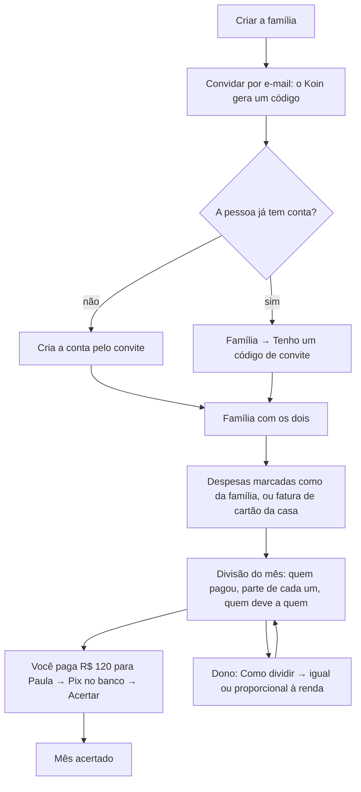

# Fluxo do produto: família, quem pagou o quê e o acerto

*Atualizado em:* 12/11/2026
*Implementação:* [koin-api#134](https://github.com/AppFinanceiro-GECS/koin-api/pull/134) e [koin-app#35](https://github.com/AppFinanceiro-GECS/koin-app/pull/35)
*Relacionado:* [O cartão nasce da fatura](fluxo-cartao-pela-fatura.md)

## Sumário

1. [Por que este fluxo](#1-por-que-este-fluxo)
2. [Inspirações](#2-inspirações)
3. [O fluxo](#3-o-fluxo)
4. [Como a divisão é calculada](#4-como-a-divisão-é-calculada)
5. [Entrar na família já tendo conta](#5-entrar-na-família-já-tendo-conta)
6. [Telas](#6-telas)
7. [API](#7-api)
8. [Próximos passos](#8-próximos-passos)

---

## 1. Por que este fluxo

O público do Koin são casais e famílias que gastam principalmente no cartão. Das três perguntas que eles fazem ([fluxo do cartão, seção 1](fluxo-cartao-pela-fatura.md#1-para-quem-é-o-koin)), a segunda é **"quem da casa gastou o quê?"**. Na prática, ela vem junto de outra: **"quem deve a quem neste mês?"**.

Antes deste fluxo, o app já criava a família e mostrava os lançamentos marcados como da casa, mas:

- a tela dizia "Divisão entre membros em breve" e o botão **Acertar** não fazia nada;
- quem já tinha conta no Koin não conseguia entrar na família: o convite para um e-mail cadastrado era recusado. Num casal, é comum os dois criarem conta antes de decidir dividir.

## 2. Inspirações

- **decade.com** (consultoria de patrimônio com IA): a força está em **uma visão consolidada**, no **resumo mensal** e em **avisar quando algo precisa de atenção**. Trouxemos isso para a casa: um número do mês, quem pagou o quê e um selo *A acertar* / *Acertado*. O decade não tem família compartilhada; essa parte é nossa.
- **Divisão de contas entre amigos** (estilo Splitwise): o saldo de cada um e o **menor número de Pix** para zerar.
- **Divisão proporcional à renda**: comum em casais brasileiros em que um ganha mais. Por isso a parte de cada um não precisa ser igual.

O que **não** fazemos, de propósito: movimentar dinheiro. O acerto é registrado pela pessoa depois do Pix no banco dela, como no resto do Koin (sem Open Finance, sem custódia).

## 3. O fluxo

## 4. Como a divisão é calculada

1. **O que entra:** despesas marcadas como da família (`ownership_type = household`) lançadas pelos membros no mês. O que é pessoal fica fora e continua privado.
2. **Quem pagou:** quem lançou a despesa. Na compra de cartão importada pela fatura, é o dono do cartão, que é quem paga a fatura.
3. **A parte de cada um:** igual entre todos, ou a porcentagem definida pelo dono da família (somando 100%). O app ajuda a calcular pela renda; a renda não é salva.
4. **Saldo:** o que pagou − a parte dele, já contando os acertos (quem pagou um acerto "pagou a casa"; quem recebeu "devolveu"). Saldo positivo recebe; negativo paga.
5. **Quem deve a quem:** o maior devedor paga o maior credor, até zerar. Com duas pessoas é sempre um Pix só.
6. Arredondamento em centavos; a sobra fica com quem tem a maior parte.

Exemplo: despesas da casa de R$ 400 (Ana pagou R$ 300, Bruno R$ 100). Partes iguais: cada um deve R$ 200, então **Bruno paga R$ 100 para Ana**. Com 60/40: Ana deveria R$ 240 e Bruno R$ 160, então **Bruno paga R$ 60 para Ana**.

## 5. Entrar na família já tendo conta

- O dono convida pelo e-mail; o Koin mostra o **código** para copiar ou compartilhar (WhatsApp).
- Quem já tem conta abre *Família → Tenho um código de convite* e cola o código.
- Regras: o convite tem que ter sido feito **para o e-mail da conta** (um código vazado não serve para outra pessoa); convite usado, cancelado ou expirado não entra; quem está **sozinho** numa família própria sai dela ao entrar; quem **divide** outra família precisa sair antes.
- Os lançamentos pessoais continuam pessoais. A família vê só o que for marcado como da casa.

## 6. Telas

| Tela | O que tem |
|---|---|
| Família (`/family`) | Membros, navegação por mês, cartão da divisão (total, quem pagou, partes, saldo, *Você paga R$ X para Fulano* com **Acertar**, acertos com **Desfazer**) e a lista de despesas da casa com *pago por Fulano*. Sozinho: atalho para entrar com código |
| Sem família | *Criar grupo familiar* e *Tenho um código de convite* |
| Entrar numa família (`/family/join`) | Campo do código e o lembrete de privacidade |
| Como dividir (`/family/shares`) | Partes iguais ou proporcional (50/50, 60/40, 70/30, *Calcular pela renda*). Só o dono salva; os outros podem simular |

## 7. API

| Rota | Uso |
|---|---|
| `GET /family/split?year&month` | Divisão do mês: `members` (pagou, parte, saldo, acertos), `transfers`, `categories`, `settlements`, `split_mode`, `is_settled` |
| `POST /family/settlements` | Registra um acerto (`to_user_id`, `amount`, `year`, `month`; `from_user_id` padrão = quem registra) |
| `DELETE /family/settlements/{id}` | Desfaz (quem registrou, quem participou ou o dono) |
| `PUT /family/shares` | Partes de cada membro (somam 100; vazio = igual). Só o dono |
| `POST /family/join` | Entrar com o código, já tendo conta |
| `POST /family/invite` | Passa a aceitar e-mail já cadastrado |
| `GET /transactions` | Passa a trazer `user_id` (quem lançou) |

Tabelas: `household_settlements` e a coluna `household_members.share_percent` (migração `add_household_settlements`).

## 8. Próximos passos

1. **Marcar o cartão como da casa** na importação da fatura, para todas as compras entrarem na divisão sem marcar uma a uma.
2. **Aviso de acerto** no fim do mês ("Você e Paula fecharam novembro: você paga R$ 120").
3. **Divisão por despesa** (uma compra só de um, outra 50/50) para quem quer mais controle.
4. **Pix copia e cola** a partir da chave do outro membro, sem o Koin movimentar dinheiro.
