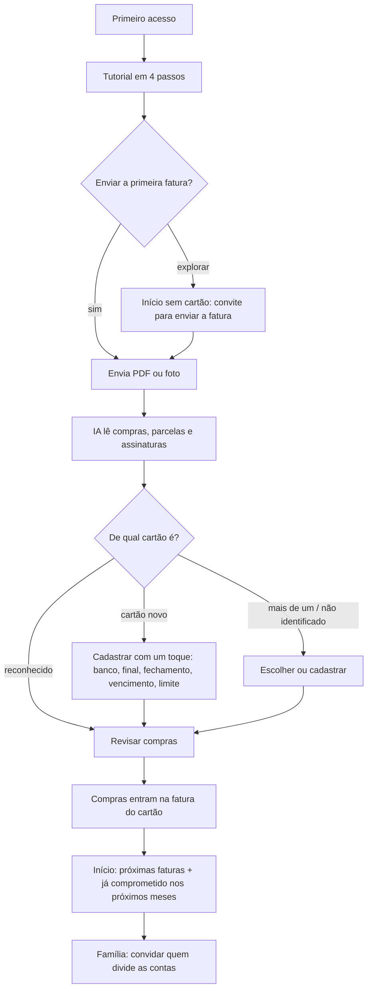
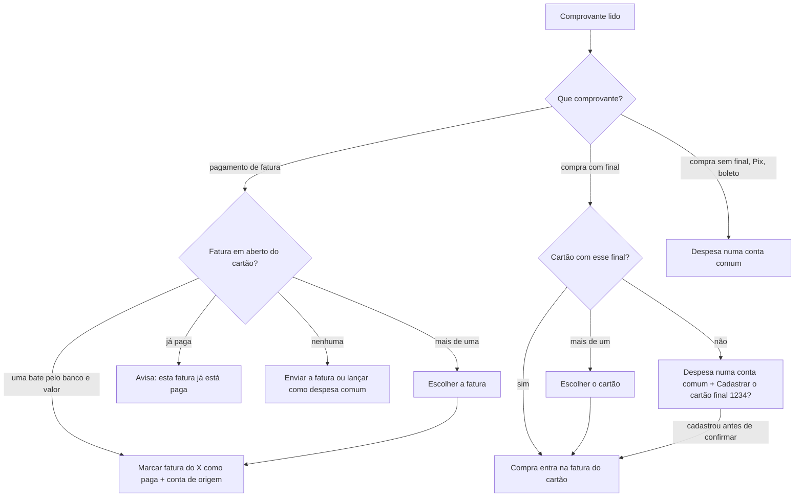

# Fluxo do produto: o cartão nasce da fatura

*Atualizado em:* 12/11/2026 (comprovantes)
*Implementação:* [koin-api#131](https://github.com/AppFinanceiro-GECS/koin-api/pull/131), [koin-app#32](https://github.com/AppFinanceiro-GECS/koin-app/pull/32), [koin-api#132](https://github.com/AppFinanceiro-GECS/koin-api/pull/132), [koin-app#33](https://github.com/AppFinanceiro-GECS/koin-app/pull/33), [koin-api#133](https://github.com/AppFinanceiro-GECS/koin-api/pull/133) e [koin-app#34](https://github.com/AppFinanceiro-GECS/koin-app/pull/34)

## Sumário

1. [Para quem é o Koin](#1-para-quem-é-o-koin)
2. [O problema do fluxo anterior](#2-o-problema-do-fluxo-anterior)
3. [O fluxo novo](#3-o-fluxo-novo)
4. [O que cada documento faz](#4-o-que-cada-documento-faz)
5. [Como o cartão é reconhecido](#5-como-o-cartão-é-reconhecido)
6. [Telas](#6-telas)
7. [API](#7-api)
8. [Comprovantes e o cartão](#8-comprovantes-e-o-cartão)
9. [Próximos passos](#9-próximos-passos)

---

## 1. Para quem é o Koin

**Casais e famílias brasileiras que gastam principalmente no cartão de crédito**, muitas vezes com dois ou três cartões e várias compras parceladas.

A dor dessas pessoas não é "quanto tenho na conta". São três perguntas:

1. Quanto vem na próxima fatura, e nas próximas seis, contando as parcelas?
2. Quem da casa gastou o quê?
3. Como não digitar compra por compra?

A promessa do MVP continua a mesma: **"A fatura chegou, o app já entende."** A leitura de fatura por IA responde à terceira pergunta. Este fluxo coloca as duas primeiras no centro do app.

## 2. O problema do fluxo anterior

O app pedia para montar tudo à mão antes de mostrar qualquer valor: cadastrar cartões, contas, dívidas e receitas. Além disso:

- **A fatura importada não ia para o cartão.** As compras confirmadas iam para a primeira conta da lista (a Carteira), sem `credit_card_id`. Por isso nunca formavam fatura nem consumiam limite.
- **A importação não sabia de qual cartão era a fatura.** A pessoa escolhia numa lista e, se não houvesse cartão, aparecia uma lista fictícia.
- **O Início mostrava saldo de conta**, um número que ninguém mantém sem integração bancária, e não mostrava o que já está comprometido no cartão.

## 3. O fluxo novo

1. **Primeiro acesso:** um tutorial curto (bem-vindo, mandar a fatura, ver o que vem, família). Ele termina com "Enviar minha primeira fatura" ou "Explorar o app" e pode ser revisto em *Mais → Rever tutorial*.
2. **A fatura vem antes do cadastro.** O cadastro manual continua existindo, mas como alternativa ("Prefiro cadastrar o cartão na mão").
3. **O cartão nasce da fatura.** O app só pergunta "é este cartão?". A fatura é a fonte do fechamento e do vencimento, que são atualizados a cada nova fatura.
4. **O Início responde às perguntas do público:**
   - *Próximas faturas:* quanto está em aberto em cada cartão e quando vence;
   - *Já comprometido nos próximos 6 meses:* as parcelas já compradas, no mês da fatura em que cada uma cai;
   - *Só eu / Família:* alterna entre o que é da pessoa e o que é da casa.
5. **Receitas, contas, dívidas e metas são opcionais e vêm depois.** Elas não bloqueiam o primeiro valor.

## 4. O que cada documento faz

Regra principal: **o cartão é um cadastro só, e só a fatura cria cartão automaticamente.** Só ela traz banco, final, fechamento, vencimento e limite. O app sempre sugere e a pessoa confirma; nunca aparece um "cartão fantasma".

| Documento | O que tem nele | O que o app faz |
|---|---|---|
| **Fatura do cartão** | banco, final, fechamento, vencimento, limite, compras | Reconhece o cartão cadastrado ou oferece cadastrar com os dados lidos |
| **Comprovante de compra no cartão** (via da maquininha, e-mail da loja) | valor, data, às vezes final e bandeira | Não cria cartão. Se um cartão tem o mesmo final, a compra entra na fatura dele. Se nenhum tem, a despesa entra numa conta comum e o app pergunta "Cadastrar o cartão final 1234?" |
| **Comprovante de PIX ou boleto** | valor, data, destinatário | Despesa da conta. Não é cartão |
| **Comprovante de pagamento da fatura** | banco do cartão, valor pago, às vezes o final | Não cria cartão. O app acha a fatura em aberto do cartão (pelo banco e pelo valor) e oferece "Marcar fatura do Nubank como paga", com a conta de onde saiu o dinheiro |
| **Cupom fiscal / nota** | itens, total, forma de pagamento | Despesa da conta, com itens |

## 5. Como o cartão é reconhecido

A API compara os dados lidos da fatura (`card_info`) com os cartões que a pessoa enxerga: os pessoais dela e os compartilhados da família.

1. **Pelo final** (4 dígitos). Se dois cartões têm o mesmo final, desempata pelo banco.
2. **Sem final,** aceita o banco quando há um único cartão dele.
3. **Cartão cadastrado à mão sem o final:** o banco basta, para não duplicar.
4. Se nada bate e o documento é uma fatura: **cartão novo**, com sugestão de cadastro.
5. Se mais de um bate: **pede para escolher**.

O cadastro pela fatura é idempotente: enviar a mesma fatura duas vezes não cria dois cartões. O cartão criado já vem com a cor do banco.

## 6. Telas

| Tela | O que mudou |
|---|---|
| Tutorial (`/onboarding`) | 4 passos com ilustrações feitas com os componentes do app. Abre no primeiro acesso de cada usuário no aparelho e pode ser revisto em *Mais* |
| Início | Sem cartão: convite "Comece pela sua fatura". Com cartão: *Próximas faturas*, *Já comprometido* (gráfico de 6 meses), alertas e resumo do mês |
| Importar fatura | Cartão opcional no envio ("Descobrir pela fatura"); o mês da fatura vem da própria fatura, sem lista de meses fixos. Na revisão, um aviso mostra o cartão reconhecido, oferece cadastrar o cartão novo (um toque ou "Ajustar") ou pede para escolher. As compras entram na conta do cartão, com mês da fatura, e os erros aparecem para a pessoa |
| Revisar comprovante | Compra com final: aviso do cartão reconhecido ("entra na fatura") ou "Cadastrar o cartão final 1234?". Pagamento de fatura: tela *Pagamento de fatura* com a fatura sugerida, a conta de origem e "Marcar fatura do X como paga" (seção 8) |
| Cartões | Sem cartão: "Enviar fatura" primeiro e "Cadastrar na mão" como alternativa. Editar, desativar e excluir conforme [koin-app#32](https://github.com/AppFinanceiro-GECS/koin-app/pull/32) |
| Formulário do cartão | Aceita dados pré-preenchidos (vindos da fatura) para ajustar antes de salvar |

## 7. API

| Rota | Uso |
|---|---|
| `GET /documents/{id}` | Ganha `card_match`: `matched` (com `credit_card_id`), `new` (com `suggestion`), `ambiguous` (com `candidate_ids`), `unregistered` (comprovante com final de cartão não cadastrado, com `suggestion`) ou `none`. Comprovantes trazem `payment_card` (final, bandeira, banco) e o de pagamento de fatura traz `invoice_payment` (seção 8) |
| `POST /invoices/{id}/pay` | Já existia. O app usa para marcar a fatura como paga a partir do comprovante, com `amount`, `payment_account_id` e `payment_date` |
| `POST /credit-cards/from-document/{document_id}` | Cadastra o cartão a partir da fatura lida. 201 ao criar, 200 se já existe um que bate, 422 `not_an_invoice` para outros documentos |
| `GET /invoices/outlook?months=6&scope=me\|family` | Parcelas já compradas por mês de fatura nos próximos N meses |
| `POST /transactions/batch-confirm` | Já aceitava `credit_card_id`, `invoice_month/year` e `card_closing_day/card_due_day`. Agora o app envia esses campos |
| `DELETE /credit-cards/{id}` | 409 `credit_card_has_linked_data` quando há lançamentos; `?force=true` apaga tudo |

`POST /invoices/detect-card` e `POST /invoices/create-card-from-invoice` ficam marcados como obsoletos: nenhuma tela usa e eles confiam em dados enviados pelo app.

## 8. Comprovantes e o cartão

A regra continua: **só a fatura cria cartão.** Comprovantes apontam para um cartão que já existe ou sugerem cadastrar; quem decide é sempre a pessoa.

### 8.1 Comprovante de pagamento da fatura → fatura paga

A IA classifica o documento como `comprovante_fatura` (pagamento de fatura de cartão, feito pelo app do banco, Pix ou boleto da fatura) e lê o banco **do cartão**, não o banco de onde saiu o dinheiro. A API procura a fatura assim:

1. **Pelo banco** (e pelo final, quando aparece) acha o cartão. Se o comprovante cita um banco que não tem cartão cadastrado, não sugere fatura de outro banco.
2. **Pelo valor**: a fatura não paga cujo total, ou o que falta pagar, é igual ao valor pago.
3. Valor diferente no cartão certo (pagamento parcial): sugere a fatura que vence mais perto da data do pagamento e avisa que ela fica parcialmente paga.
4. Sem banco no comprovante: casa só pelo valor; se nenhum valor fecha, a pessoa escolhe entre as faturas em aberto.
5. O mesmo comprovante de novo: avisa que a fatura já está paga.

O app mostra a fatura sugerida, pede a conta de origem (só contas que não são cartão) e registra o pagamento com `POST /invoices/{id}/pay`. Como o pagamento não é uma despesa nova, ele não entra como compra; se a pessoa preferir, "Lançar como despesa comum" continua disponível.

### 8.2 Comprovante de compra com final → cartão

A IA guarda o final, a bandeira e, se aparecer, o banco do cartão (`payment_card`) em comprovantes, cupons e notas. O reconhecimento é o mesmo da fatura (seção 5), mas **só pelo final**: sem os 4 dígitos, a compra fica numa conta comum.

| Resultado | O que o app faz |
|---|---|
| Um cartão tem o final | "Compra no cartão · entra na fatura". A compra vai para a conta do cartão, com `credit_card_id`, e a API calcula a fatura pela data e pelo fechamento. "Não foi nele" volta para a conta comum |
| Mais de um cartão tem o final | Pede para escolher |
| Nenhum cartão tem o final | "Cadastrar o cartão final 1234?" abre o formulário do cartão com nome, final e bandeira. Se a pessoa cadastra antes de confirmar, a compra já vai para o cartão novo; se não, entra na conta comum e a pergunta aparece de novo no fim |

## 9. Próximos passos

Em ordem de valor para o público:

1. **Encaminhar a fatura por e-mail.** Quase todo banco manda o PDF por e-mail. Um endereço do Koin que recebe e importa sozinho resolve o ritual mensal sem Open Finance.
2. **Aviso de fatura fechada** ("Sua fatura do Nubank fechou, mande o PDF"), usando a data de fechamento que veio da própria fatura.
3. **Open Finance:** avaliar depois de medir retenção. Exige ser instituição autorizada pelo Banco Central ou contratar um agregador, além de CNPJ, custo por conexão e mais responsabilidade de LGPD.
